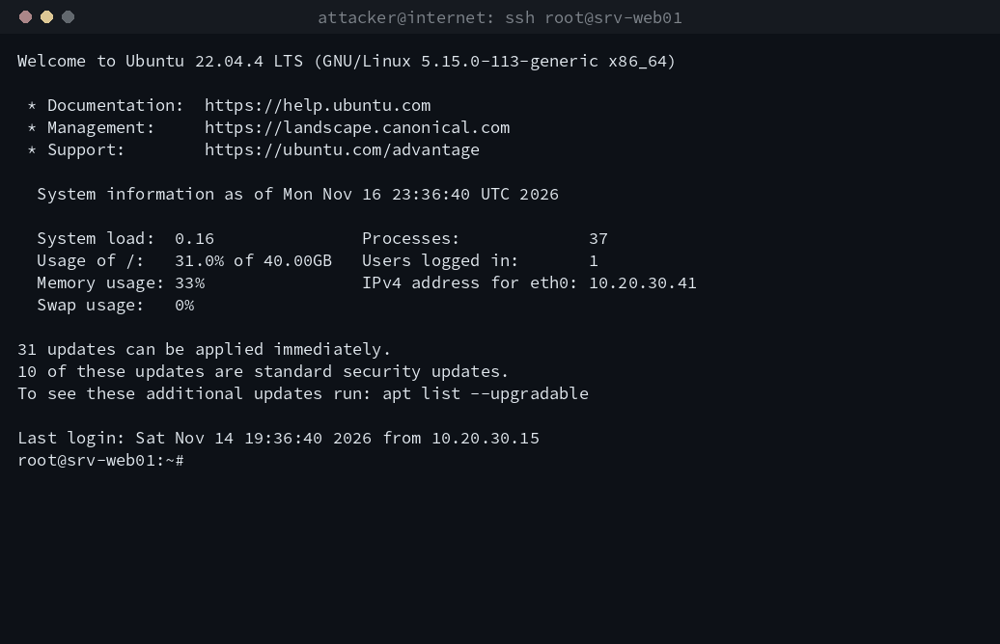
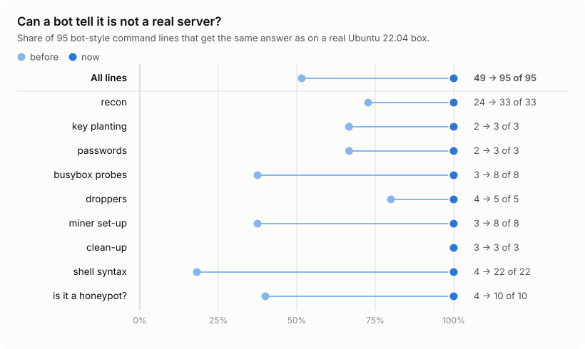
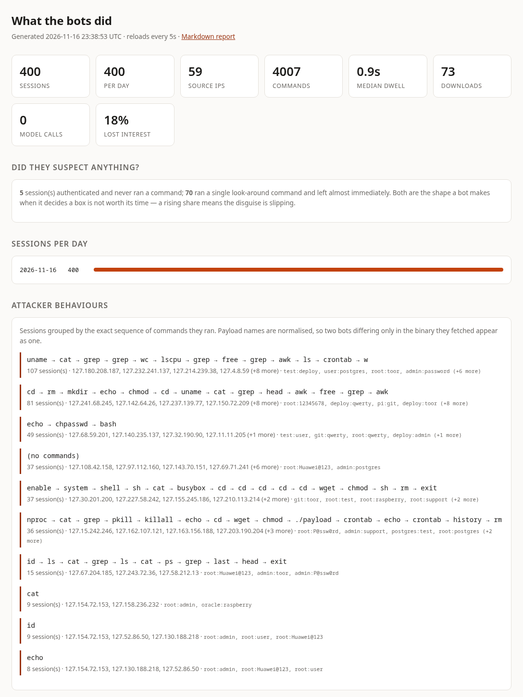
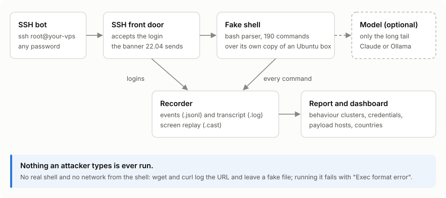

# llm-honeypot

An SSH honeypot that lets any bot log in, hands it a fake Ubuntu server that
answers like the real thing, and records everything it tries. Nothing the
attacker types is ever run.



<sub>The honeypot's own recording of a scripted attacker session. The
credentials in <code>.env</code> are fake bait, the download never happens, and
the "binary" refuses to run.</sub>

## Can a bot tell it is a honeypot?

Bots check a box by running ordinary commands and watching for answers a real
server never gives: `awk: command not found`, a syntax error on `2>&1`, an SSH
banner from the wrong Ubuntu release. So the honeypot is measured against a
real one. Bot-style command lines run once in the honeypot and once in a stock
Ubuntu 22.04 container, and the answers are compared.



| Lines answered like Ubuntu 22.04 | Before | Now |
|---|---:|---:|
| [Development set](tools/fidelity/corpus.txt) | 49 / 95 | **95 / 95** |
| [Held-out set](tools/fidelity/holdout.txt), first run | | **59 / 65** |
| Giveaways in the development set | 29 | **0** |

A giveaway is an answer no stock server gives: `command not found` for a tool
Ubuntu ships, a syntax error on valid bash, binary garbage on the screen.

The development set drove the fixes, so its 95 of 95 mostly shows what was
fixed. The held-out set is the fairer number: 65 new lines, scored on their
first run. The gaps it found (five missing or incomplete commands) are fixed
since, and its one remaining difference is a test that depended on the box's
own files. Every line and every difference: [docs/fidelity.md](docs/fidelity.md),
[docs/fidelity-holdout.md](docs/fidelity-holdout.md). Rerun with `make fidelity`.

## What it records



<sub>The dashboard after a lab run: 400 scripted sessions from 60 simulated bots
on loopback (<code>tools/lab</code>), not real attacks.</sub>

Every connection is saved as structured events, a readable transcript and a
replay of the attacker's screen. `honeypot report` turns them into a Markdown
summary; `honeypot dashboard` serves the page above.

## Quick start

Needs Go 1.26 or Docker.

```sh
git clone https://github.com/amirradjou/llm-honeypot && cd llm-honeypot
make run                       # SSH on port 2222, recordings in ./data
```

In another terminal:

```sh
ssh -p 2222 root@localhost     # any password; try uname -a, wget, crontab -l
./bin/honeypot dashboard       # then open http://127.0.0.1:8080
```

Or `docker compose up --build`. To catch real bots, run it on a throwaway VPS
with your real sshd moved off port 22 first. Never on a machine that matters.

## How it works



The shell is written in Go: a bash parser and interpreter with 190 commands,
running over a private copy of a seeded Ubuntu filesystem for each session.
The model is optional and off by default. When it is on (Claude with your own
key, or a local Ollama model), it only answers commands and files the shell
does not know, and attacker text reaches it only inside a fixed frame.

Configuration, the report, payload capture, the model backend and how the
pictures above were made: [docs/GUIDE.md](docs/GUIDE.md).

## License

MIT. This is a defensive tool: it watches unsolicited attacks on a machine you
control and never attacks back or runs attacker code. You are responsible for
where you deploy it.
